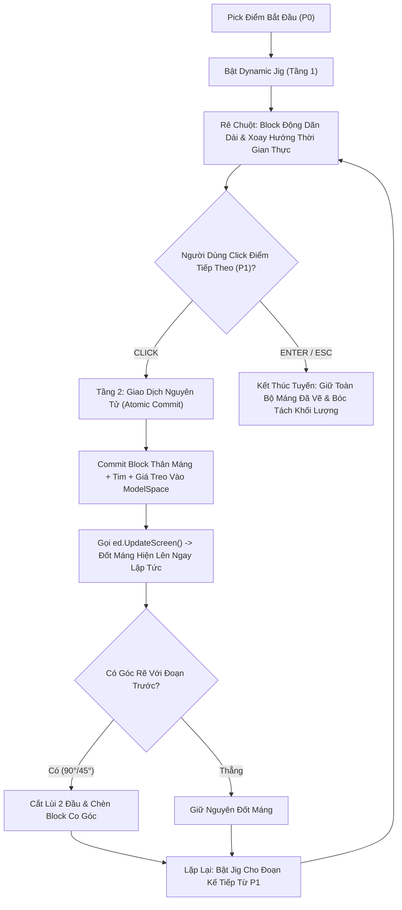

# Kỹ Năng Vẽ Thang Máng Cáp Trực Quan Thời Gian Thực (Live Dynamic Cable Tray Jig)

Tài liệu này định nghĩa bộ quy chuẩn kiến trúc, giải thuật hình học và mã nguồn mẫu chuẩn sản phẩm để xây dựng công cụ vẽ **Thang Máng Cáp MEP (Trunking / Ladder / Tray)** trong AutoCAD .NET Add-in, giải quyết triệt để vấn đề "vẽ mù" bằng cơ chế **hiển thị Block động chạy theo chuột trong thời gian thực** và **chèn hiện hữu ngay lập tức sau mỗi cú click**.

---

## 1. Vấn Đề Thực Tế & Trải Nghiệm Người Dùng (UX)

### Hạn Chế Của Cách Tiếp Cận Truyền Thống ("Vẽ Mù")
* Kỹ sư pick điểm 1, điểm 2, điểm 3... trên màn hình chỉ thấy một sợi dây cao su mờ nhạt (Rubberband Line đơn).
* Người dùng không nhìn thấy được độ dày bề rộng máng ($W$), không ước lượng được khoảng hở với dầm cột, ống gió lân cận.
* Chỉ khi nhấn **ENTER** kết thúc lệnh thì hàng loạt Block mới đột ngột xuất hiện. Nếu góc rẽ bị va chạm hoặc chiều dài không khớp, kỹ sư phải xóa đi vẽ lại từ đầu rất tốn thời gian.

### Trải Nghiệm "Live Dynamic Placement" Chuẩn Cao Cấp
1. **Rê chuột tới đâu - Block động dãn tới đó (Real-Time Dragging):** Khi di chuyển con trỏ chuột, hình dáng thực tế của máng cáp (2 cạnh biên $W$, nắp đậy, đường tim, nan thang rải đều 250mm) lập tức dãn dài và xoay hướng mượt mà 60 FPS theo chuột.
2. **Click chuột tới đâu - Thang máng hiện ngay tới đó (Immediate Commit):** Mỗi cú nhấp chuột xác nhận một đỉnh tuyến đường, đoạn máng đó lập tức được lưu vào bản vẽ và hiển thị rõ ràng trên màn hình (`ed.UpdateScreen()`), không phải chờ lệnh kết thúc.
3. **Tự động chèn Co phụ kiện và cắt lùi góc bẻ:** Khi rẽ hướng (90° hoặc 45°), hệ thống tự tính toán khoảng lùi, chèn Block Co rẽ chuẩn tỷ lệ $W$ và nối tiếp đoạn máng mới liền mạch.
4. **Nhấn ESC/ENTER bảo toàn kết quả:** Nếu người dùng nhấn ESC hoặc ENTER, toàn bộ các đoạn máng đã vẽ trước đó được giữ nguyên vẹn trên bản vẽ, kèm báo cáo tổng chiều dài và số lượng phụ kiện.

---

## 2. Kiến Trúc 2 Tầng Hiển Thị Trực Quan (Two-Tier Live Architecture)



---

## 3. Triển Khai Kỹ Thuật Chi Tiết

### 3.1. Tầng 1: Lớp Dynamic Jig Hiển Thị Trực Quan (`CableTrayDrawJig`)

Sử dụng `DrawJig` kế thừa từ `Autodesk.AutoCAD.EditorInput.DrawJig` với đồ họa `WorldGeometry.WorldLine` tốc độ cao không gây trễ giao diện:

```csharp
using System;
using Autodesk.AutoCAD.ApplicationServices;
using Autodesk.AutoCAD.DatabaseServices;
using Autodesk.AutoCAD.EditorInput;
using Autodesk.AutoCAD.Geometry;
using Gi = Autodesk.AutoCAD.GraphicsInterface;

public class CableTrayDrawJig : DrawJig
{
    private Point3d _startWcs;
    private Point3d _curWcs;
    private double _widthMm;
    private int _trayType; // 0: Trunking, 1: Ladder, 2: Tray
    private Matrix3d _ucsToWcs;
    private Matrix3d _wcsToUcs;

    public Point3d CurrentWcsPoint => _curWcs;

    public CableTrayDrawJig(Point3d startWcs, double widthMm, int trayType, Matrix3d ucsToWcs)
    {
        _startWcs = startWcs;
        _curWcs = startWcs;
        _widthMm = widthMm;
        _trayType = trayType;
        _ucsToWcs = ucsToWcs;
        _wcsToUcs = ucsToWcs.Inverse();
    }

    protected override SamplerStatus Sampler(JigPrompts prompts)
    {
        JigPromptPointOptions opts = new JigPromptPointOptions("\n[TMC] Chọn điểm tiếp theo trên tuyến (hoặc ENTER/ESC để hoàn thành): ");
        opts.UserInputControls = UserInputControls.Accept3dCoordinates |
                                 UserInputControls.NoZeroResponseAccepted |
                                 UserInputControls.NullResponseAccepted;
        opts.BasePoint = _startWcs.TransformBy(_wcsToUcs);
        opts.UseBasePoint = true;
        opts.Cursor = CursorType.RubberBand;

        PromptPointResult res = prompts.AcquirePoint(opts);
        if (res.Status == PromptStatus.OK)
        {
            Point3d newWcs = res.Value.TransformBy(_ucsToWcs);
            if (newWcs.DistanceTo(_curWcs) < 1.0)
            {
                return SamplerStatus.NoChange;
            }
            _curWcs = newWcs;
            return SamplerStatus.OK;
        }
        return SamplerStatus.Cancel;
    }

    protected override bool WorldDraw(Gi.WorldDraw draw)
    {
        double dist = _startWcs.DistanceTo(_curWcs);
        if (dist < 5.0) return true;

        Vector3d dir = (_curWcs - _startWcs).GetNormal();
        Vector3d normal = new Vector3d(-dir.Y, dir.X, 0);
        double halfW = Math.Max(50.0, _widthMm / 2.0);

        Point3d leftStart = _startWcs + normal * halfW;
        Point3d leftEnd = _curWcs + normal * halfW;
        Point3d rightStart = _startWcs - normal * halfW;
        Point3d rightEnd = _curWcs - normal * halfW;

        // 1. Vẽ 2 cạnh biên màu cam đặc trưng MEP (ACI 30)
        draw.SubEntityTraits.Color = 30;
        draw.Geometry.WorldLine(leftStart, leftEnd);
        draw.Geometry.WorldLine(rightStart, rightEnd);

        // 2. Nắp chặn mặt cắt đầu mút
        draw.Geometry.WorldLine(leftStart, rightStart);
        draw.Geometry.WorldLine(leftEnd, rightEnd);

        // 3. Đường tim định tâm màu xám (ACI 8)
        draw.SubEntityTraits.Color = 8;
        draw.Geometry.WorldLine(_startWcs, _curWcs);

        // 4. Nếu là Thang Cáp (Ladder): Tự sinh các nan thang cách nhau 250mm chạy theo chuột
        if (_trayType == 1)
        {
            draw.SubEntityTraits.Color = 30;
            double step = 250.0;
            double cur = step;
            while (cur < dist - 50.0)
            {
                Point3d pA = _startWcs + dir * cur + normal * halfW;
                Point3d pB = _startWcs + dir * cur - normal * halfW;
                draw.Geometry.WorldLine(pA, pB);
                cur += step;
            }
        }
        else if (_trayType == 2)
        {
            // Khay cáp đục lỗ: Vẽ 2 gờ mép viền trong
            draw.SubEntityTraits.Color = 8;
            double flange = Math.Min(30.0, halfW / 4.0);
            draw.Geometry.WorldLine(_startWcs + normal * (halfW - flange), _curWcs + normal * (halfW - flange));
            draw.Geometry.WorldLine(_startWcs - normal * (halfW - flange), _curWcs - normal * (halfW - flange));
        }

        return true;
    }
}
```

---

### 3.2. Tầng 2: Động Cơ Chèn & Hiển Thị Tức Thì (`Immediate Incremental Commit`)

Quy tắc bất di bất dịch (Tuân thủ 100% Skill `cad-strict-block-enforcement`):
* **Không để người dùng chờ đến khi kết thúc lệnh mới chèn Block**.
* **100% sử dụng Block DWG từ thư viện** (`HTS Cable tray.dwg`, `HTS Ladder.dwg`, `HTS Elbow...dwg`, `HTS Reducer...dwg`). **CẤM TỰ TẠO BLOCK** hoặc vẽ LINE thay thế.

Mỗi lần `ed.Drag()` trả về `PromptStatus.OK`:
1. Giao dịch nguyên tử xóa các thực thể tạm thời của bước trước (`oldEntitiesToErase`).
2. Tính góc bẻ hướng tại đỉnh gần nhất; nếu có góc rẽ thì chèn Co góc (90° hoặc 45°) với khoảng lùi tiêu chuẩn.
3. Chèn `BlockReference` thân máng động (`HTS Cable tray` hoặc `HTS Ladder` nạp từ thư viện), gán `AttributeReference` kích thước `W{W}xH{H}`, tim máng và giá đỡ Unistrut.
4. `tr.Commit()` ngay lập tức và gọi `ed.UpdateScreen()`.

```csharp
public static bool DrawCableTrayManualInteractive(Document doc, CableTrayParams p)
{
    Editor ed = doc.Editor;
    PromptPointOptions ppo = new PromptPointOptions("\n[TMC] Chọn điểm đầu tuyến Thang Máng Cáp: ");
    PromptPointResult ppr = ed.GetPoint(ppo);
    if (ppr.Status != PromptStatus.OK) return false;

    Point3d wcsStart = ppr.Value.TransformBy(ed.CurrentUserCoordinateSystem);
    List<Point3d> pathPts = new List<Point3d> { wcsStart };
    List<ObjectId> currentEntities = new List<ObjectId>();

    while (true)
    {
        Point3d lastWcs = pathPts[pathPts.Count - 1];
        CableTrayDrawJig jig = new CableTrayDrawJig(lastWcs, p.WidthMm, (int)p.Type, ed.CurrentUserCoordinateSystem);

        PromptResult pr = ed.Drag(jig);
        if (pr.Status != PromptStatus.OK)
        {
            // Người dùng nhấn ENTER hoặc ESC: Hoàn tất tuyến
            break;
        }

        Point3d nextWcs = jig.CurrentWcsPoint;
        if (nextWcs.DistanceTo(lastWcs) < 10.0) continue;

        pathPts.Add(nextWcs);

        // CHÈN VÀ HIỂN THỊ NGAY LẬP TỨC:
        List<ObjectId> newEntities = new List<ObjectId>();
        RouteCableTrayAlongPointsInternal(
            doc,
            pathPts,
            p,
            oldEntitiesToErase: currentEntities,
            outCreatedIds: newEntities,
            writeMessage: false
        );

        currentEntities = newEntities;
        ed.UpdateScreen(); // Cập nhật màn hình AutoCAD ngay trong nháy mắt
    }

    if (pathPts.Count >= 2)
    {
        ed.WriteMessage(string.Format("\n[TMC] Hoàn tất vẽ tuyến Thang Máng Cáp W{0:F0}xH{1:F0}mm!", p.WidthMm, p.HeightMm));
        return true;
    }
    return false;
}
```

---

### 3.3. Tự Động Co Dãn Block Tham Số Động & Gán Attribute

Khi chèn `BlockReference` cho từng đoạn thẳng:
1. **Kiểm tra thuộc tính động (Dynamic Block Properties):** Tìm các tham số `Distance1`, `Distance`, `Length` để gán đúng độ dài thực tế `prop.Value = dist`.
2. **Hệ số Scale dự phòng:** Nếu Block không có thuộc tính động chiều rộng $W$, tự động gán `ScaleY = widthMm / baseWidth`.
3. **Gán AttributeReference:** Duyệt qua `BlockTableRecord` để khởi tạo thuộc tính `W{W}xH{H}` cho nhãn mác kỹ thuật hiển thị đúng trên CAD và Properties (Ctrl+1).

---

## 4. Các Bẫy Kỹ Thuật Cần Tránh (Gotchas)

1. **Bẫy Không Cập Nhật Màn Hình:** Trong các phiên bản AutoCAD mới, nếu chỉ commit `Transaction` mà không gọi `ed.UpdateScreen()`, khung nhìn viewport sẽ bị hoãn làm mới đồ họa cho đến khi lệnh kế tiếp chạy. **Bắt buộc** gọi `ed.UpdateScreen()` sau mỗi lần commit đoạn mới.
2. **Bẫy Lỗi Khóa Bản Vẽ (`eLockViolation`):** Khi lệnh được gọi từ nút bấm Palette (WPF Modeless Window), phải bao bọc toàn bộ khối commit trong `using (doc.LockDocument())`. Khóa tài liệu chỉ giữ trong khoảng thời gian cực ngắn (vài mili-giây) khi ghi đè thực thể, không giữ khóa trong lúc chờ người dùng kéo chuột (`ed.Drag`).
3. **Bẫy Trôi Điểm Khi UCS Đang Xoay:** Con trỏ chuột nhận từ `JigPrompts.AcquirePoint` luôn trả về tọa độ theo hệ **UCS**. Bắt buộc phải nhân ma trận `.TransformBy(ucsToWcs)` để tính toán hình học trong hệ thế giới **WCS** của `ModelSpace`.
4. **Bẫy Mất Đối Tượng Khi Nhấn ESC:** Khi người dùng nhấn ESC ở bước pick thứ 4, tuyến máng với 3 đoạn đầu tiên và 2 Co rẽ đã được commit trước đó vẫn phải được bảo toàn nguyên vẹn trên bản vẽ, không bị xóa mất.
