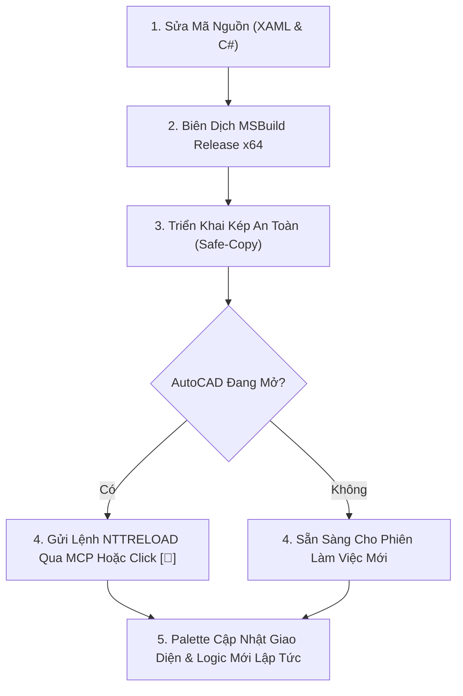

# Kỹ Năng Tự Động Cập Nhật & Làm Mới Palette AutoCAD (CAD Palette Hot-Reload)

Kỹ năng định nghĩa quy trình chuẩn hóa và tự động hóa 100% việc đồng bộ mã nguồn, biên dịch, triển khai nhị phân và làm mới giao diện Palette của AutoCAD Add-in ngay sau mỗi lần chỉnh sửa mã nguồn (XAML/C#), đảm bảo kỹ sư nhìn thấy giao diện mới nhất lập tức mà không bao giờ phải tắt và khởi động lại AutoCAD.

---

## 1. Bản Chất Kỹ Thuật & Thách Thức Cốt Lõi

Trong môi trường AutoCAD .NET API (.NET Framework 4.8 / .NET 8.0):
1. **Khóa Tệp Nhị Phân (Assembly File Locking):** Khi AutoCAD nạp DLL qua Autoloader Bundle hoặc lệnh `NETLOAD`, tiến trình `acad.exe` sẽ khóa tệp DLL trên đĩa (`ERROR_SHARING_VIOLATION`), khiến MSBuild hoặc lệnh sao chép thông thường thất bại.
2. **Cơ Chế Cache AppDomain:** Trong một phiên làm việc, nếu nạp lại một Assembly có cùng phiên bản danh tính (`Identity`), .NET CLR sẽ tái sử dụng Assembly cũ trong bộ nhớ, không cập nhật mã IL mới.
3. **Cây Giao Diện WPF Cũ (Stale Visual Tree):** Cửa sổ Palette gắn dock (`PaletteSet`) giữ tham chiếu đến instance UserControl cũ, cần cơ chế chủ động phá hủy Visual cũ và tái tạo UserControl mới.

---

## 2. Kiến Trúc Giải Pháp 3 Trụ Cột (Zero-Restart Solution)

### Trụ Cột 1: Cơ Chế Nạp Nhị Phân Trực Tiếp Qua Bộ Nhớ (In-Memory Hot Reload)
Trong phương thức mở Palette `ShowTaiAiPalette()` (gắn lệnh `NTT`, `TaiAi`, `NTTRELOAD`), không khởi tạo trực tiếp instance phụ thuộc cứng vào assembly cũ. Thay vào đó:
* Đọc toàn bộ byte của file DLL mới nhất vừa build trên đĩa: `byte[] rawBytes = File.ReadAllBytes(dllPath);`
* Nạp assembly độc lập vào bộ nhớ: `Assembly latestAsm = Assembly.Load(rawBytes);`
* Trích xuất Type `TaiAiAddin.Views.TaiAiPaletteControl` từ assembly mới nhất và khởi tạo: `(Visual)Activator.CreateInstance(ctrlType);`
* Xóa visual cũ khỏi `_paletteSet`: `while (_paletteSet.Count > 0) _paletteSet.Remove(0);`
* Gán visual mới: `_paletteSet.AddVisual("Tiêu đề", newVisual);`

### Trụ Cột 2: Triển Khai An Toàn Bằng Kỹ Thuật Đổi Tên NTFS (Safe-Copy NTFS Fallback)
Mặc dù Windows ngăn ghi đè lên file DLL đang mở, hệ thống tệp NTFS **cho phép đổi tên file đang mở** nếu file được mở với quyền chia sẻ `FileShare.Delete`.
* Quy trình:
  1. Thử `Copy-Item -Force` tệp `TaiAiAddin.dll` sang thư mục Bundle.
  2. Nếu bị chặn do AutoCAD đang chạy, tự động đổi tên file đích cũ thành `TaiAiAddin.dll.<guid>.old`.
  3. Sao chép ngay file DLL mới biên dịch vào đường dẫn đích chuẩn `TaiAiAddin.dll`.

### Trụ Cột 3: Kích Hoạt Tự Động Đa Kênh (Multi-Channel Trigger)
* **Kênh Tự Động Qua AI (MCP Tool):** AI sử dụng tool `send_command` của MCP server `autocad-2023` gửi lệnh `NTTRELOAD ` ngay sau khi build. Kỹ sư thấy Palette tự động nháy cập nhật giao diện mới nhất.
* **Kênh Nút Bấm Trên Palette:** Nút `btnReloadPalette` (`[🔄]`) trên Header Palette gọi `doc.SendStringToExecute("NTTRELOAD\n", true, false, false);`.
* **Kênh Dòng Lệnh:** Kỹ sư có thể gõ trực tiếp `NTTRELOAD`, `NTT_RELOAD` hoặc `NTT` trên AutoCAD Command Line.

---

## 3. Quy Trình 5 Bước Bắt Buộc Sau Mỗi Lần Sửa Mã Nguồn

Mỗi khi AI hoàn thành việc chỉnh sửa mã nguồn giao diện (XAML), logic điều khiển (`.xaml.cs`) hoặc các Service liên quan:



### Bước 1: Đồng Bộ Mã XAML & Code-Behind
* Đảm bảo mọi control mới đều có `x:Name`, kiểm tra `Margin`, `Padding` theo lưới 8px.
* Kiểm tra `Theme.xaml` để đảm bảo không bị lỗi `StaticResource` không tồn tại.
* Toàn bộ nhãn nút bấm, tooltip và thông báo trạng thái phải là 100% tiếng Việt kỹ thuật có dấu.

### Bước 2: Biên Dịch Headless Qua MSBuild
Chạy lệnh biên dịch Release x64 với cấu hình chuẩn:
```powershell
C:\Windows\Microsoft.NET\Framework64\v4.0.30319\MSBuild.exe TaiAiAddin\TaiAiAddin.csproj /p:Configuration=Release /p:Platform=x64 /v:m
```
* Bắt buộc kiểm tra kết quả `0 Error(s)`. Nếu có lỗi, xử lý ngay trước khi triển khai.

### Bước 3: Triển Khai Nhị Phân Kép
Triển khai file DLL tới cả 2 vị trí:
1. `.\TaiAiAddin.bundle\Contents\TaiAiAddin.dll` (Thư mục dự án)
2. `%APPDATA%\Autodesk\ApplicationPlugins\TaiAiAddin.bundle\Contents\TaiAiAddin.dll` (Thư mục nạp tự động của AutoCAD)

Có thể chạy trực tiếp script tự động:
```powershell
powershell -NoProfile -ExecutionPolicy Bypass -File .agents\skills\cad-palette-updater\scripts\reload_palette.ps1
```

### Bước 4: Làm Mới Palette Trên AutoCAD
* Gọi MCP tool `send_command` với `command: "NTTRELOAD "` để AutoCAD nạp giao diện mới.
* Hoặc thông báo kỹ sư nhấn nút `[🔄]` trên thanh Header của Palette.

---

## 4. Đoạn Mã Mẫu Chuẩn Cho Commands.cs & PaletteControl.xaml.cs

### Mã Nạp Hot Reload Trong `Commands.cs`:
```csharp
[CommandMethod("TaiAi")]
[CommandMethod("NTT")]
[CommandMethod("NTTRELOAD")]
[CommandMethod("NTT_RELOAD")]
[CommandMethod("TaiAiReload")]
public void ShowTaiAiPalette()
{
    try
    {
        if (_paletteSet == null)
        {
            _paletteSet = new PaletteSet("NTT TOOLS - Trợ Lý MEP", new Guid("3B1B916A-1B8C-4F7D-B2B2-747A9A167C55"));
            _paletteSet.Style = PaletteSetStyles.ShowAutoHideButton |
                                PaletteSetStyles.ShowCloseButton |
                                PaletteSetStyles.ShowPropertiesMenu;
            _paletteSet.MinimumSize = new Size(320, 500);
            _paletteSet.Size = new Size(380, 650);
        }

        while (_paletteSet.Count > 0)
        {
            _paletteSet.Remove(0);
        }

        // Đọc trực tiếp byte từ DLL trên đĩa để nạp giao diện vừa build
        System.Windows.Media.Visual newVisual = null;
        try
        {
            string dllPath = typeof(Commands).Assembly.Location;
            if (!string.IsNullOrEmpty(dllPath) && File.Exists(dllPath))
            {
                byte[] rawBytes = File.ReadAllBytes(dllPath);
                Assembly latestAsm = Assembly.Load(rawBytes);
                Type ctrlType = latestAsm.GetType("TaiAiAddin.Views.TaiAiPaletteControl");
                if (ctrlType != null)
                {
                    newVisual = Activator.CreateInstance(ctrlType) as System.Windows.Media.Visual;
                }
            }
        }
        catch { }

        if (newVisual != null)
        {
            _paletteSet.AddVisual("Thiết Kế / Shop / BKL", newVisual);
        }
        else
        {
            _paletteControl = new TaiAiPaletteControl();
            _paletteSet.AddVisual("Thiết Kế / Shop / BKL", _paletteControl);
        }

        _paletteSet.Visible = true;
    }
    catch (System.Exception ex)
    {
        Application.ShowAlertDialog("Lỗi làm mới Palette: " + ex.Message);
    }
}
```

### Mã Xử Lý Nút Bấm Trên `TaiAiPaletteControl.xaml.cs`:
```csharp
private void BtnReloadPalette_Click(object sender, RoutedEventArgs e)
{
    try
    {
        if (txtStatus != null) txtStatus.Text = "Đang làm mới giao diện Palette theo mã nguồn mới nhất...";
        Document doc = Application.DocumentManager.MdiActiveDocument;
        if (doc != null)
        {
            // Bắn lệnh NTTRELOAD lên Command Line chính của AutoCAD
            doc.SendStringToExecute("NTTRELOAD\n", true, false, false);
        }
    }
    catch { }
}
```

---

## 5. Các Bẫy Cần Tránh Khi Hot Reload Palette (Gotchas)

1. **Rò Rỉ Bộ Nhớ AppDomain:** Mỗi lần gọi `Assembly.Load(byte[])` sẽ nạp một assembly mới vào AppDomain hiện hành. Trong một phiên làm việc phát triển (vài chục lần reload), dung lượng RAM tiêu thụ thêm chỉ khoảng 20-50MB, hoàn toàn an toàn. Khi đóng AutoCAD, toàn bộ bộ nhớ được giải phóng sạch sẽ.
2. **Dọn Rác Các Tệp `.old`:** Các tệp `TaiAiAddin.dll.<guid>.old` được tạo ra khi AutoCAD đang khóa file sẽ được script tự động dọn sạch khi AutoCAD đóng hoặc khởi động phiên mới.
3. **Dispatcher & UI Thread:** Mọi thao tác gán Visual vào `PaletteSet` bắt buộc phải thực thi trên STA Main Thread của AutoCAD. Lệnh `SendStringToExecute` tự động bảo đảm chạy đúng luồng chính an toàn.
