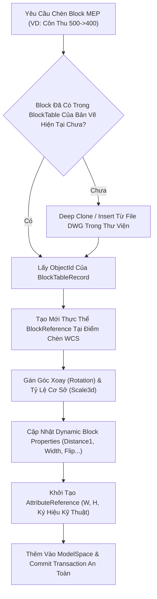

# Quy Chuẩn Kỹ Thuật Bắt Buộc 100% Sử Dụng Block Thư Viện (Strict Block Enforcement)

Tài liệu này là bộ luật kỹ thuật tối cao (Zero-Tolerance Anti-Pattern) dành cho AI khi lập trình add-in C#, AutoLISP, hoặc kích hoạt các tool vẽ trên AutoCAD. 

Mọi cấu kiện, thiết bị, phụ kiện MEP (Thang máng cáp, Côn thu, Co rẽ, Tê, Thập, Tủ điện, Ổ cắm, Đầu phun PCCC, Cụm bơm, Miệng gió) **BẮT BUỘC 100% PHẢI ĐƯỢC CHÈN TỪ FILE DWG THƯ VIỆN CÓ SẴN CỦA DỰ ÁN**. 

---

## 1. Điều Cấm Tuyệt Đối (Zero-Tolerance Anti-Patterns)

> [!CAUTION]
> **CÁC HÀNH VI SAU ĐÂY BỊ NGHIÊM CẤM 100% VÀ COI LÀ LỖI NGHIÊM TRỌNG:**
> 1. **CẤM TỰ TẠO BLOCK MỚI:** Tuyệt đối không dùng code tạo block nặc danh (`*U...`), không gọi `entmake '((0 . "BLOCK")...)`, không tạo `BlockTableRecord` mới từ mã nguồn rỗng.
> 2. **CẤM VẼ HÌNH HỌC NGUYÊN THỦY THAY THẾ BLOCK:** Tuyệt đối không vẽ các nét `LINE`, `LWPOLYLINE`, `ARC`, `HATCH`, `TEXT` rời rạc để vẽ mô phỏng thân máng, co rẽ, côn thu, tủ điện hoặc thiết bị MEP.
> 3. **CẤM TỰ ĐẶT TÊN BLOCK LẠ:** Không sử dụng các tên block tự chế không nằm trong danh mục thư viện dự án đã được định nghĩa.

---

## 2. Đường Dẫn Cây Thư Viện Dự Án (Project Library Registry)

Thư mục gốc thư viện dự án:
`D:\01. NGUYEN TAN TAI\CODING AI\00.BAI 1_TOOLS\Thư Viện`

### 2.1. Phân Hệ Thang Máng Cáp (`Thư Viện\Điện\Thang máng\`)

| Tên Cấu Kiện MEP | Tên File Block DWG Thư Viện | Ứng Dụng & Tham Số Động (Dynamic Block) |
| :--- | :--- | :--- |
| **Đoạn Thẳng Máng Cáp** | `HTS Cable tray.dwg` | Thân máng cáp (Trunking/Tray). Kéo dài bằng `Distance1` hoặc `Distance`. Bề rộng gán qua thuộc tính `Width` hoặc `ScaleY`. |
| **Đoạn Thẳng Thang Cáp** | `HTS Ladder.dwg` | Thân thang cáp (Cable Ladder). Kéo dài bằng `Distance1`, rải nan tự động theo chiều dài. |
| **Co Vuông Máng 90°** | `HTS Elbow cable tray.dwg` | Phụ kiện co 90° máng cáp. Điều chỉnh bán kính cong $R$ và bề rộng $W$. |
| **Co Vuông Thang 90°** | `HTS Elbow ladder.dwg` | Phụ kiện co 90° thang cáp có nan. |
| **Co Vát Máng 45°** | `HTS Elbow 45 cable tray.dwg`| Co góc 45° cho tuyến máng cáp chuyển hướng vát. |
| **Co Vát Thang 45°** | `HTS Elbow 45 ladder.dwg` | Co góc 45° cho tuyến thang cáp. |
| **Côn Thu Máng Cáp** | `HTS Reducer cable tray.dwg` | Phụ kiện giảm cấp kích thước máng (VD: 500W -> 400W, 400W -> 300W...). Gán $W_1, W_2$. |
| **Côn Thu Thang Cáp** | `HTS Reducer ladder.dwg` | Phụ kiện giảm cấp thang cáp đồng tâm. |
| **Côn Lệch Thang Cáp** | `HTS-CONLECH-THANGCAP.dwg`| Phụ kiện giảm cấp thang cáp lệch một bên (giữ mép tường/mép dầm). |
| **Tê Máng Cáp (Ngã 3)** | `HTS Tee cable tray.dwg` | Phụ kiện chia 3 nhánh máng cáp. |
| **Tê Thang Cáp (Ngã 3)** | `HTS Tee ladder.dwg` | Phụ kiện chia 3 nhánh thang cáp. |
| **Thập Máng Cáp (Ngã 4)** | `HTS Cross cable tray.dwg` | Phụ kiện chia 4 nhánh máng cáp. |
| **Thập Thang Cáp (Ngã 4)** | `HTS Cross ladder.dwg` | Phụ kiện chia 4 nhánh thang cáp. |
| **Co Lên Máng Cáp** | `HTS Elbow up cable tray.dwg`| Co đứng hướng lên (tăng cao độ $H$). |
| **Co Xuống Máng Cáp** | `HTS Elbow down cable tray.dwg`| Co đứng hướng xuống (hạ cao độ $H$). |
| **Co Lên Thang Cáp** | `HTS Elbow up ladder.dwg` | Co đứng hướng lên cho thang cáp. |
| **Co Xuống Thang Cáp**| `HTS Elbow down ladder.dwg` | Co đứng hướng xuống cho thang cáp. |
| **Co Z Máng Cáp** | `HTS Elbow Z cable tray.dwg` | Co Z vượt chướng ngại vật (dầm, ống gió). |
| **Co Z Thang Cáp** | `HTS Elbow Z ladder.dwg` | Co Z cho thang cáp. |
| **Mặt Cắt Máng Lên/Xuống** | `HTS-CUT-MANGCAP-COLEN.dwg`, `HTS-CUT-MANGCAP-COXUONG.dwg` | Ký hiệu mặt cắt máng cáp xuyên sàn/thay đổi cao độ. |
| **Mặt Cắt Thang Lên/Xuống**| `HTS-CUT-THANGCAP-UP.dwg`, `HTS-CUT-THANGCAP-DOWN.dwg` | Ký hiệu mặt cắt thang cáp xuyên sàn. |
| **Giá Treo Đỡ Máng/Thang** | `HTS-GIADO.dwg` | Cụm Unistrut, ty treo M10/M12 và bát treo máng cáp. |

### 2.2. Các Phân Hệ MEP Khác Trong Thư Viện

* **Điện - Hộp & Tủ Điện (`Thư Viện\Điện\BOX ĐIỆN\`):**
  * Tủ tổng: `HTS-Tudien-MSB-1200x800x2200.dwg`, `HTS-Tudien-MSB-2400x800x2200.dwg`
  * Tủ phân phối tầng: `HTS-Tudien-DB-600x250x800.dwg`, `HTS-Tudien-DBT-800x300x1200.dwg`, `HTS-Tudien-SDB-800x400x1800.dwg`
  * Tủ căn hộ & module: `HTS-Tudien-DBCH-400x120x500.dwg`, `HTS-Tudien-TudienModule.dwg`, `HTS-Tudien-LP-500x200x700.dwg`
  * Tủ điều khiển & nguồn: `HTS-Tudien-ATS-1000x600x2000.dwg`, `HTS-Tudien-MCC-1000x600x2000.dwg`, `HTS-Tudien-CAP-800x600x2000.dwg`
  * Ổ cắm & công tắc: `HTS-OCAM-O cam cac loai.dwg`, `Hopchiadien.dwg`
* **Điều Hòa Không Khí (`Thư Viện\DHKK\`):**
  * Dàn lạnh: `Dan_Lanh_FCU_Giau_Tran.dwg`, Dàn nóng: `Dan_Nong_VRV_VRF.dwg`
  * Bộ chia gas Daikin: `Bo_Chia_Gas_Daikin_KHRQ22M20T.dwg`, `Bo_Chia_Gas_Daikin_Header_8Nga.dwg`, v.v.
  * Miệng gió: `Mieng_Gio_Khuech_Tan_Vuong.dwg`, `Mieng_Gio_Hoi_Khe_Slot.dwg`, `Mieng_Gio_Nan_Louver.dwg`
  * Phụ kiện ống gió: `Van_Dap_Lua_FD.dwg`, `Van_Gio_Vuong_VCD.dwg`, `Van_Gio_Tron_VCD.dwg`, `Cua_Tham_Ong_Gio.dwg`
* **Cấp Thoát Nước (`Thư Viện\CTN\`):**
  * Thiết bị vệ sinh: `Ban_Cau_Ket_Hop.dwg`, `Chau_Rua_Lavabo.dwg`, `Chau_Rua_Bat_KitchenSink.dwg`, `Sen_Tam_Dung.dwg`, `Tieu_Nam_Treo_Tuong.dwg`
  * Phụ kiện & trạm: `Pheu_Thu_San_FloorDrain.dwg`, `Dong_Ho_Do_Nuoc_D15.dwg`, `Ho_Ga_Thu_Nuoc_Thai.dwg`, `Be_Tu_Hoai_SepticTank.dwg`, `Cum_Bom_Cap_Nuoc_Booster.dwg`, `Van_Cong_Khoa_Nuoc.dwg`, `Van_Mot_Chieu_CheckValve.dwg`
* **PCCC (`Thư Viện\PCCC\`):**
  * Đầu phun: `Sprinkler_Pendant.dwg`, `Sprinkler_Upright.dwg`, `Sprinkler_Sidewall.dwg`
  * Báo cháy & thiết bị chữa cháy: `Dau_Bao_Khoi.dwg`, `Dau_Bao_Nhiet.dwg`, `Nut_Nhan_Khan.dwg`, `Chuong_Den_Bao_Chay.dwg`, `Hong_Tiep_Nuoc_2Nga.dwg`, `Binh_MFZ4_Bot.dwg`, `Binh_MT3_CO2.dwg`

---

## 3. Quy Trình 3 Bước Nạp & Chèn Block Chuẩn Kỹ Thuật



---

## 4. Chuẩn Triển Khai Mã Nguồn (Reference Implementations)

### 4.1. Chuẩn C# (.NET Core / CAD API): Nạp File DWG & Chèn Dynamic Block

```csharp
using System;
using System.IO;
using Autodesk.AutoCAD.ApplicationServices;
using Autodesk.AutoCAD.DatabaseServices;
using Autodesk.AutoCAD.Geometry;

public static class LibraryBlockManager
{
    private static readonly string LibraryRoot = @"D:\01. NGUYEN TAN TAI\CODING AI\00.BAI 1_TOOLS\Thư Viện";

    /// <summary>
    /// Đảm bảo Block DWG từ thư viện đã được nạp vào bản vẽ hiện hành.
    /// Nếu chưa có, nạp nguyên vẹn cấu trúc Block DWG vào Database.
    /// </summary>
    public static ObjectId EnsureBlockLoaded(Database destDb, string subFolder, string blockFileName)
    {
        string blockName = Path.GetFileNameWithoutExtension(blockFileName);
        
        using (Transaction tr = destDb.TransactionManager.StartTransaction())
        {
            BlockTable bt = (BlockTable)tr.GetObject(destDb.BlockTableId, OpenMode.ForRead);
            if (bt.Has(blockName))
            {
                ObjectId id = bt[blockName];
                tr.Commit();
                return id;
            }
            tr.Commit();
        }

        string fullDwgPath = Path.Combine(LibraryRoot, subFolder, blockFileName);
        if (!File.Exists(fullDwgPath))
        {
            throw new FileNotFoundException($"Không tìm thấy file Block thư viện tại: {fullDwgPath}");
        }

        // Nạp Block từ file DWG ngoài vào bản vẽ hiện hành
        ObjectId importedId = ObjectId.Null;
        using (Database sourceDb = new Database(false, true))
        {
            sourceDb.ReadDwgFile(fullDwgPath, FileOpenMode.OpenForReadAndAllShare, true, "");
            importedId = destDb.Insert(blockName, sourceDb, true);
        }

        return importedId;
    }

    /// <summary>
    /// Chèn BlockReference từ thư viện và cập nhật các tham số động Dynamic Block
    /// </summary>
    public static ObjectId InsertMepBlock(
        Database db,
        string subFolder,
        string blockFileName,
        Point3d insertPtWcs,
        double rotationRad,
        double? dynamicLengthMm = null,
        double? dynamicWidthMm = null)
    {
        ObjectId btrId = EnsureBlockLoaded(db, subFolder, blockFileName);
        if (btrId.IsNull) return ObjectId.Null;

        using (Transaction tr = db.TransactionManager.StartTransaction())
        {
            BlockTableRecord btrCurrent = (BlockTableRecord)tr.GetObject(SymbolUtilityServices.GetBlockModelSpaceId(db), OpenMode.ForWrite);
            
            using (BlockReference br = new BlockReference(insertPtWcs, btrId))
            {
                br.Rotation = rotationRad;
                br.ScaleFactors = new Scale3d(1.0, 1.0, 1.0);

                ObjectId brId = btrCurrent.AppendEntity(br);
                tr.AddNewlyCreatedDBObject(br, true);

                // Cập nhật Dynamic Block Properties nếu có
                if (br.IsDynamicBlock)
                {
                    DynamicBlockReferencePropertyCollection props = br.DynamicBlockReferencePropertyCollection;
                    foreach (DynamicBlockReferenceProperty prop in props)
                    {
                        if (prop.ReadOnly) continue;

                        string propName = prop.PropertyName.Trim();
                        if (dynamicLengthMm.HasValue && (propName.Equals("Distance1", StringComparison.OrdinalIgnoreCase) || 
                                                         propName.Equals("Distance", StringComparison.OrdinalIgnoreCase) ||
                                                         propName.Equals("Length", StringComparison.OrdinalIgnoreCase)))
                        {
                            prop.Value = dynamicLengthMm.Value;
                        }
                        else if (dynamicWidthMm.HasValue && (propName.Equals("Width", StringComparison.OrdinalIgnoreCase) || 
                                                             propName.Equals("Distance2", StringComparison.OrdinalIgnoreCase)))
                        {
                            prop.Value = dynamicWidthMm.Value;
                        }
                    }
                }

                tr.Commit();
                return brId;
            }
        }
    }
}
```

---

### 4.2. Chuẩn AutoLISP: Nạp & Chèn Block Thư Viện

Khi viết AutoLISP, **tuyệt đối không dùng `entmake` để tự tạo Block**. Bắt buộc chèn bằng `-INSERT` trỏ trực tiếp đến file DWG trong thư viện:

```lisp
;;; Hàm nạp và chèn Block DWG từ thư viện chuẩn 100%
(defun Insert-Library-Block (subfolder dwgName pt rot scaleW scaleL / fullPath blkName)
  (setq fullPath (strcat "D:\\01. NGUYEN TAN TAI\\CODING AI\\00.BAI 1_TOOLS\\Thư Viện\\" subfolder "\\" dwgName))
  (setq blkName (vl-filename-base dwgName))
  
  (if (not (tblsearch "BLOCK" blkName))
    (if (findfile fullPath)
      ;; Nạp block từ file DWG thư viện vào bản vẽ
      (command-s "-INSERT" fullPath nil)
      (princ (strcat "\n[LỖI] Không tìm thấy file: " fullPath))
    )
  )
  
  ;; Chèn BlockReference vào vị trí WCS
  (if (tblsearch "BLOCK" blkName)
    (progn
      (command-s "-INSERT" blkName pt scaleW scaleL (angtos rot 0 4))
      (entlast)
    )
    nil
  )
)

;;; Ví dụ chèn Côn Thu Máng Cáp 500w -> 400w:
;;; (Insert-Library-Block "Điện\\Thang máng" "HTS Reducer cable tray.dwg" (list 0 0 0) 0.0 1.0 1.0)
```

---

## 5. Ví Dụ Cụ Thể: Tuyến Máng Giảm Cấp 500W -> 400W -> 300W -> 200W -> 100W -> 50W

Khi người dùng yêu cầu vẽ tuyến máng cáp giảm cấp:
1. **Đoạn 1 (500W):** Chèn `HTS Cable tray.dwg`, gán thuộc tính động độ rộng $W = 500$, chiều dài $L$.
2. **Nối 1:** Chèn Côn Thu `HTS Reducer cable tray.dwg`, gán đầu vào $W_1 = 500$, đầu ra $W_2 = 400$.
3. **Đoạn 2 (400W):** Chèn `HTS Cable tray.dwg`, gán $W = 400$, chiều dài $L$.
4. **Nối 2:** Chèn Côn Thu `HTS Reducer cable tray.dwg`, gán $W_1 = 400$, đầu ra $W_2 = 300$.
5. **... Tiếp tục tương tự cho đến 50W.**
6. **Mọi phụ kiện và thân máng đều là `BlockReference` có nguồn gốc từ file DWG trong thư viện.**

---

## 6. Bảng Kiểm Tra Tuân Thủ Trước Khi Xuất Code (Pre-Delivery Checklist)

Trước khi gửi bất kỳ đoạn mã hoặc file LISP/C# nào cho người dùng, AI phải tự kiểm tra 4 tiêu chí sau:

- [ ] **1. Không có lệnh tạo block nặc danh:** Không chứa `entmake` cho `BLOCK`, không chứa `new BlockTableRecord()` để vẽ nét mới rồi lưu thành block.
- [ ] **2. 100% Block có nguồn gốc DWG rõ ràng:** Mọi block đều map đúng tên file trong bảng tra cứu tại Mục 2.
- [ ] **3. Không vẽ hình học chay thay thế:** Không vẽ Line/Polyline để làm co rẽ hay côn thu. Toàn bộ hình dáng hiển thị đều đến từ Block Thư Viện.
- [ ] **4. Quản lý lỗi mượt mà:** Nếu file DWG thư viện bị thiếu, mã nguồn phải thông báo đường dẫn file cụ thể cho người dùng thay vì tự tiện vẽ tạm bằng nét Line.
